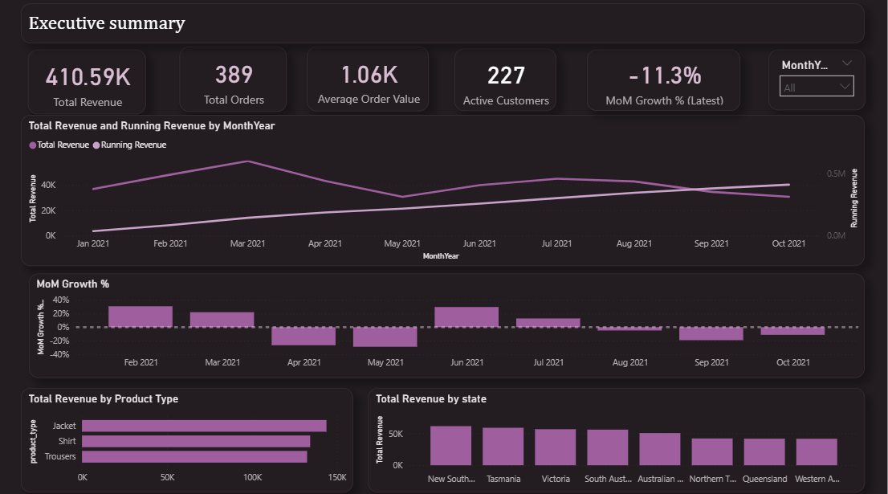
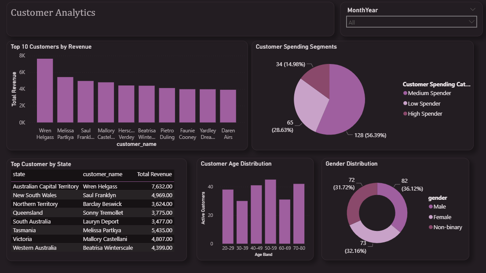
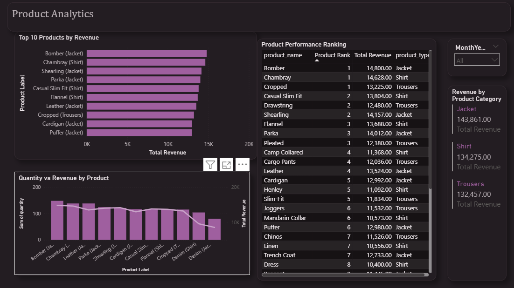

# 🛒 E-Commerce Analytics Dashboard

### End-to-End Data Analytics Project | SQL → Power BI → DAX

## 📌 Project Overview

An end-to-end e-commerce analytics project that takes a relational SQL dataset (Customers, Orders, Products, Sales) through to a 3-page interactive Power BI dashboard. The same analytical logic is implemented twice, once in SQL and once in DAX, to show both skill sets working toward the same business questions.

**Dataset:** sample e-commerce data (not a real business), covering January 2021 to October 2021.

```text
Raw E-Commerce Dataset
        ↓
SQL Database (4 tables, 13 queries, 4 views)
        ↓
Power BI Import
        ↓
Star Schema Data Model
        ↓
DAX Measures + Date Table
        ↓
3-Page Interactive Dashboard
```

---

## 📊 Key Findings

| Metric | Result |
|---|---|
| Total revenue | 410.59K across 389 orders |
| Average order value | about 1.06K |
| Active customers | 227 |

- **Revenue peaked in March 2021 (about 59K), fell to a low in May (about 31K), and has declined in each of the last three months (Aug to Oct).** Month-over-month growth was -19.2% in September and -11.3% in October.
- **Customers are mostly mid-tier:** 128 medium spenders (56%), 65 low (29%) and 34 high spenders (15%).
- **Revenue is evenly spread across categories:** Jackets 143.9K (35%), Shirts 134.3K (33%), Trousers 132.5K (32%).
- **No single product dominates.** The top 10 products each earn between about 13.0K and 14.8K, with Bomber (Jacket) first at 14.8K (about 3.6% of revenue).
- **No single customer dominates.** The top customer contributes under 2% of total revenue.
- Customers are balanced by gender (36% / 32% / 32%) and spread across age bands, with 50-59 the largest.

**What I would investigate next:** the August to October decline, by category and by state, to see whether it is broad-based or concentrated.

---

## 🎯 Business Problem

An e-commerce business generates data across customers, orders, products, and transactions. This project turns that raw data into decision-ready insights, answering questions such as:

- How much revenue is the business generating, and is it growing month over month?
- Which customers and products drive the most revenue?
- How are customers distributed across spending segments, gender, and age?
- Who is the top customer in each state?
- Which product categories and individual products perform best?
- How do units sold compare with revenue across products?

---

## 🛠️ Tools & Technologies

| Tool | Purpose |
|---|---|
| MySQL | Table design, joins, CTEs, window functions, views |
| Power BI | Data modeling and dashboard design |
| DAX | Measures, time intelligence, ranking, segmentation |
| Power Query | Data loading and transformation |

---

## 🗄️ Database Design

Four relational tables with primary/foreign key relationships:

```text
Customers ──customer_id──► Orders ──order_id──► Sales ◄──product_id── Products
```

- **Customers**: customer_id, customer_name, gender, age, city, state, country
- **Orders**: order_id, customer_id, payment, order_date, delivery_date
- **Products**: product_id, product_type, product_name, size, colour, price
- **Sales**: sales_id, order_id, product_id, price_per_unit, quantity, total_price

---

## 🔍 SQL Analysis

13 analytical queries covering joins, a CTE-based customer segmentation model, and window functions:

```sql
RANK()        -- customer spending rank
DENSE_RANK()  -- product ranking
ROW_NUMBER()  -- top customer per state (PARTITION BY state)
LAG()         -- previous month revenue
SUM() OVER()  -- running revenue
```

Four reusable views were also built (`vw_monthly_sales`, `vw_customer_summary`, `vw_product_summary`, `vw_kpi_summary`) and used as a **QA/validation layer**. See [Key Decisions](#-key-decisions) below.

---

## ⭐ Power BI Data Model

A star schema was built using the **raw tables**, not the SQL views. This was a deliberate design decision (explained below).

```text
                 DateTable
                     │
                     ▼
Customers ───► Orders ───► Sales ◄─── Products
```

- One-to-many, single-direction relationships
- Dedicated `DateTable` built with `CALENDAR()` and related to `Orders[order_date]` to support time intelligence

---

## 🧮 Key DAX Measures

```DAX
Total Revenue = SUM(Sales[total_price])

Total Orders = DISTINCTCOUNT(Sales[order_id])

Active Customers = DISTINCTCOUNT(Orders[customer_id])

Average Order Value = DIVIDE([Total Revenue], [Total Orders])

Running Revenue =
CALCULATE(
    [Total Revenue],
    FILTER(ALLSELECTED(DateTable), DateTable[Date] <= MAX(DateTable[Date]))
)

Previous Month Revenue =
CALCULATE([Total Revenue], DATEADD(DateTable[Date], -1, MONTH))

MoM Growth % =
DIVIDE([Total Revenue] - [Previous Month Revenue], [Previous Month Revenue])

MoM Growth % (Latest) =
VAR LastOrder  = MAX(Orders[order_date])
VAR MonthStart = DATE(YEAR(LastOrder), MONTH(LastOrder), 1)
VAR CurRev =
    CALCULATE([Total Revenue], ALL(DateTable),
        Orders[order_date] >= MonthStart, Orders[order_date] <= LastOrder)
VAR PrevRev =
    CALCULATE([Total Revenue], ALL(DateTable),
        Orders[order_date] >= EDATE(MonthStart, -1),
        Orders[order_date] <= EOMONTH(MonthStart, -1))
RETURN DIVIDE(CurRev - PrevRev, PrevRev)

Product Rank =
RANKX(ALL(Products[product_name]), [Total Revenue], , DESC, Dense)

Spending Category =
SWITCH(
    TRUE(),
    [Total Revenue] > 3000, "High Spender",
    [Total Revenue] >= 1000, "Medium Spender",
    "Low Spender"
)
```

`Product Rank` keeps the product-type filter from the table visual, so products are ranked **within each category** (rank 1 appears once per category).

**Calculated columns**

```DAX
Product Label = Products[product_name] & " (" & Products[product_type] & ")"

Age Band =
SWITCH(TRUE(),
    customers[age] < 30, "20-29",
    customers[age] < 40, "30-39",
    customers[age] < 50, "40-49",
    customers[age] < 60, "50-59",
    customers[age] < 70, "60-69",
    "70-80")
```

### SQL → DAX Mapping

| Business Logic | SQL | Power BI / DAX |
|---|---|---|
| Running Revenue | `SUM() OVER()` | `Running Revenue` |
| Month-over-Month | `LAG()` | `Previous Month Revenue`, `MoM Growth %` |
| Product Ranking | `DENSE_RANK()` | `Product Rank` |
| Customer Segmentation | `CASE` + `RANK()` | `Spending Category` |
| Top Customer per State | `ROW_NUMBER()` + `PARTITION BY` | Table visual, one top customer per state |

---

## 🎨 Key Decisions

**Why raw tables instead of SQL views for the data model?**
The four SQL views are pre-aggregated, which freezes their grain and blocks re-slicing by filters like date range or product type. Row-level detail (needed for future drillthrough) only exists in the raw `Sales` table. The views were kept in the SQL script and used to cross-check DAX measure totals as a validation step, rather than feeding the model directly.

**Design system:** consistent dark-mode theme with a custom "Vintage Violet" palette (`#9F5F9F`, `#C8A2C8`, `#8A496B`, `#DABFD4`, `#7C5C6F`) applied across all pages.

---

## ✅ Validation & Fixes

Checks made while reviewing the dashboard, and what they changed:

- **MoM KPI card:** with no month selected, the original measure compared the whole period with a shifted copy of itself and showed +8.1% while revenue was falling. I added `MoM Growth % (Latest)`, which compares the latest month with the one before it. The card now shows -11.3%, matching the filtered September (-19.2%) and October values.
- **Duplicate product names:** the same product name (for example, Denim) exists under two product types, and charts grouped by name merged them into one inflated bar. I added `Product Label` (name plus type) so each product is counted separately.
- **Misleading totals:** removed a table total that summed only the rows shown, and grouped single ages into age bands to make the age chart readable.
- **Cross-page reconciliation:** gender, spending segments and age bands each add up to the 227 active customers, and category revenue adds up to the 410.59K total.

---

## 📈 Dashboard Pages

### 1️⃣ Executive Summary
High-level business health at a glance.
- KPI row: Total Revenue, Total Orders, Average Order Value, Active Customers, MoM Growth % (latest month)
- Revenue and Running Revenue trend (dual-axis line chart)
- MoM Growth % by month
- Revenue by Product Type
- Revenue by State
- MonthYear slicer

### 2️⃣ Customer Analytics
Who buys, and who matters most.
- Top 10 Customers by Revenue
- Customer Spending Segments (High / Medium / Low)
- Customer Age Distribution (by age band)
- Gender Distribution
- Top Customer by State (mirrors the SQL `ROW_NUMBER()` + `PARTITION BY` query)

### 3️⃣ Product Analytics
What's driving performance on the product side.
- Top 10 Products by Revenue
- Product Performance Ranking (rank within each category)
- Quantity vs Revenue by Product
- Revenue by Product Category

---

## 📷 Dashboard Preview

### Executive Summary



### Customer Analytics



### Product Analytics



---

## 📁 Project Structure

```text
E-Commerce-Analytics-Dashboard
│
├── SQL
│   └── ecommerce_analysis.sql
│
├── PowerBI
│   └── E-Commerce_Analytics_Dashboard.pbix
│
├── img
│   ├── Executive_Summary.png
│   ├── Customer_Analytics.png
│   └── Product_Analytics.png
│
└── README.md
```

---

## 🚀 Planned Next Steps

- Customer drillthrough page (order history, purchase detail)
- Bookmark-based page navigation
- RFM customer segmentation
- Field parameters / metric toggle
- Power BI Service publishing

---

## 💼 Skills Demonstrated

```text
SQL · Joins · CTEs · Window Functions · SQL Views
Power BI · Data Modeling · Star Schema · DAX · Time Intelligence
Data Validation · Data Visualization · Business Analysis · Dashboard Design
```
